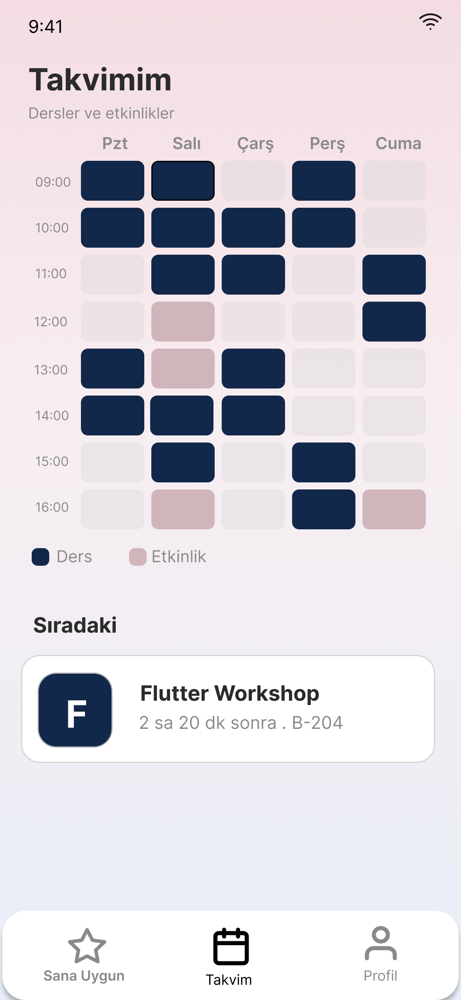

# KampüsAjanda

A Flutter app that brings all YTU campus events together in one place, helps students never miss them, and recommends events based on their free time and interests.

**Course:** MTM4681 Mobile Application Development · **Submission:** Milestone (Design and architecture) · **Team:** 8

## About the project
**Problem:** Campus events are announced on many channels (Instagram, WhatsApp groups, posters), and none of them knows a student's timetable. In our survey of 14 YTU students, 13 had missed at least one event in the last month, and 64% said class conflicts were the main reason.

**Key features**
- Sign up with a school e-mail, choose interests and enter the weekly timetable
- **For You:** events ranked by free time and interests, with the reason for each recommendation
- Event details, joining, a reminder 1 day before, and weather for outdoor events
- A calendar that shows classes and joined events together
- **Club panel:** club admins activate it with a code from SKS, create events and manage up to 3 admins

**Planned tech stack:** Flutter, MVVM with Riverpod, go_router, Firebase (Authentication, Cloud Firestore), Hive, Open-Meteo API, local notifications

## Team
| Name | Student ID | GitHub | Role |
|---|---|---|---|
| Elif Ağpınar | 24052090 | [@elifagpnr](https://github.com/elifagpnr) | UX, user flow, wireframes |
| Zeynep Yüksel | 23052005 | [@z-yuksel](https://github.com/z-yuksel) | UI, mockups, prototype |
| Nisa Ay | 23052069 | [@Nisa-Ay](https://github.com/Nisa-Ay) | Architecture, repository, submission |

## 📌 Milestone deliverables
| Deliverable | Link |
|---|---|
| 1. Design justification (PDF) | [docs/1_design_justification.pdf](docs/1_design_justification.pdf) |
| 2. User flow diagram (PDF) | [docs/2_user_flow.pdf](docs/2_user_flow.pdf) |
| 3. Wireframes (Figma) | [Open in Figma](https://www.figma.com/design/Y415Npy0OPBdq1MTyeVegD/kampusAjanda?node-id=0-1&t=rQY6gObqAMpDMv0V-1) |
| 4. Mockups (Figma) | [Open in Figma](https://www.figma.com/design/Y415Npy0OPBdq1MTyeVegD/kampusAjanda?node-id=102-68&t=vB6WrWu6mQZFdfmE-1) |
| 5. Prototype (Figma) | [Open prototype](https://www.figma.com/proto/Y415Npy0OPBdq1MTyeVegD/kampusAjanda?node-id=125-1514&p=f&t=QVs4HW59ZUosI7gC-1&scaling=min-zoom&content-scaling=fixed&page-id=125%3A1513&starting-point-node-id=125%3A1514&show-proto-sidebar=1) |
| 6. Architecture & protocols (PDF) | [docs/3_architecture_protocols.pdf](docs/3_architecture_protocols.pdf) |

The Figma file and the prototype can be viewed without logging in.

## Screens
<table><tr><td align="center"><br><sub>For You (home)</sub></td><td align="center"><br><sub>Event detail (outdoor)</sub></td><td align="center"><br><sub>Calendar</sub></td><td align="center"><br><sub>Club panel</sub></td></tr></table>

All wireframes and mockups are in [docs/screens](docs/screens) and in the Figma links above.

## Repository structure
```
docs/
├── 1_design_justification.pdf
├── 2_user_flow.pdf
├── 3_architecture_protocols.pdf
├── design/      MVVM diagram (.drawio, .png)
├── screens/     wireframe and mockup exports (PNG)
├── source/      draft texts of the documents (the final versions are the PDFs)
└── survey/      user survey questions and results (14 YTU students)
```
